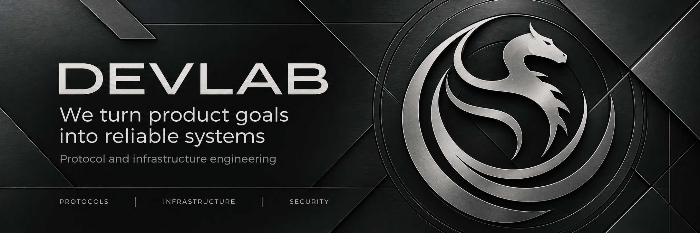

  

  <a href="https://devlab.group/">Website</a> &nbsp;·&nbsp;
  <a href="https://devlab.group/work">Selected work</a> &nbsp;·&nbsp;
  <a href="https://devlab.group/how-we-work">How we work</a> &nbsp;·&nbsp;
  <a href="mailto:dmitry@devlab.group">Start a conversation</a>

## Engineering with ownership

We are **DevLab**, an engineering team building protocols, financial infrastructure, and the systems around them. Since 2018, we have worked on **20+ projects**, taking responsibility for architecture, implementation, integrations, and production delivery.

We work with founders and product teams on new products, help recover existing systems, and own technical workstreams alongside in-house engineers.

| Focus | Engineering scope |
| :--- | :--- |
| **Protocols & DeFi** | Smart contracts, liquidity mechanics, oracles, governance, and settlement. |
| **RWA & tokenization** | Asset issuance, permissioned transfers, supply controls, and redemption on EVM and Solana. |
| **Payments & stablecoins** | Payment flows, treasury operations, settlement infrastructure, and agent commerce. |
| **Smart accounts & wallets** | Session keys, delegated execution, recovery, permissions, and wallet integrations. |
| **Backend & infrastructure** | APIs, indexers, integrations, deployment, monitoring, and production operations. |
| **Security & tooling** | Contract and infrastructure reviews, remediation, MCP scanning, and verifiable audit trails. |

&nbsp;&nbsp;
## Open source & public engineering

Tools and platforms we build in-house. Each repository documents its setup, scope, and usage terms.

### Protocols & financial infrastructure

| Project | What it does |
| :--- | :--- |
| **[Agent Commerce Gateway](https://github.com/devlab-group/agent-commerce)** | Connects existing APIs to AI agents through HTTP and MCP, with x402 payments and a shared execution pipeline. Self-hosted and non-custodial. |
| **[RWA Platform · EVM](https://github.com/devlab-group/rwa-platform-evm)** | Permissioned ERC-20 tokenization with auditor-attested supply changes, controlled transfers, and on-chain cash redemption. |

### Security & operations

| Project | What it does |
| :--- | :--- |
| **[MCP Scanner](https://github.com/devlab-group/mcp-scanner)** | Scans MCP servers, source trees, and packages, reporting security findings and analysis coverage gaps. |
| **[Postflight](https://github.com/devlab-group/postflight)** | A single-file Bash audit for Linux server security and health, with suggested fixes and text, JSON, or Prometheus output. |
| **[Immutable Audit](https://github.com/devlab-group/immutable-audit)** | An eBPF proof of concept for tamper-evident process execution logs: hash-chained events, a remote collector, and independent verification. |

### Beyond the repositories

- **[ERC-8409](https://ethereum-magicians.org/t/erc-8409-signed-service-payment-quotes/29577)** — a draft proposal for provider-signed EVM service payment quotes, separating commercial terms from payment authorization and settlement.
- **[RepoLore](https://chatgpt.com/plugins/plugin_asdk_app_6a898067d0b08191af8af6660eb1a9a5)** — our plugin for tracing public code history through commits, pull requests, issues, and regressions.

